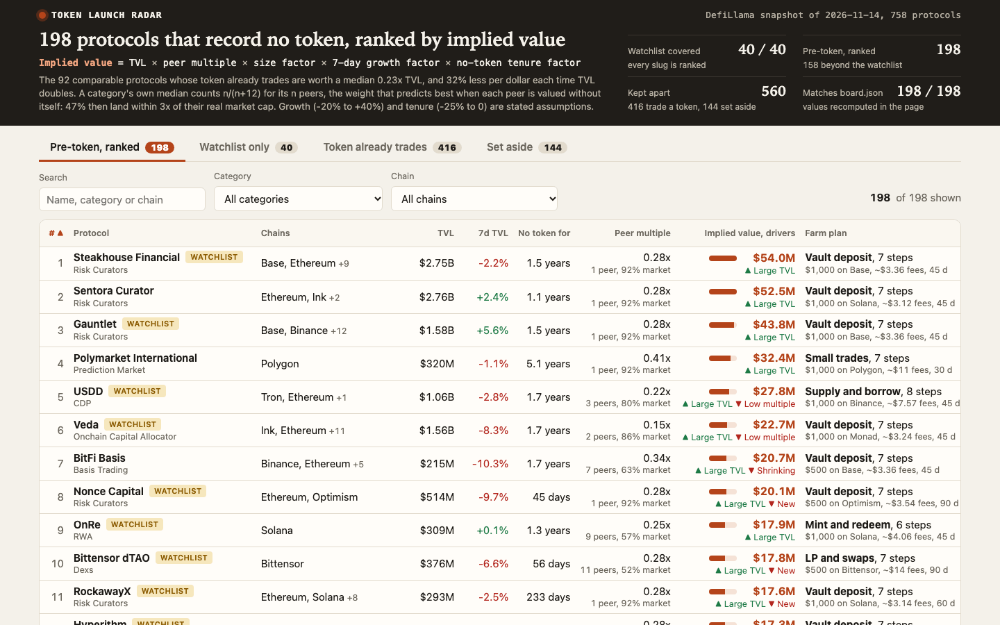

# token-radar

[](https://make.fun/bounty/token-radar-01?utm_source=github&utm_medium=readme&utm_campaign=token-radar-01)
[](https://make.fun/bounty/token-radar-01/leaderboard?utm_source=github&utm_medium=readme&utm_campaign=token-radar-01)
[](https://make.fun/bounty/token-radar-01?utm_source=github&utm_medium=readme&utm_campaign=token-radar-01)

A token launch radar: it reads one sealed DefiLlama snapshot (758 protocols) and ranks the 198 that record no token by what a token would be worth, with a farm plan for each. An entry for the [make.fun token-radar-01 bounty](https://make.fun/bounty/token-radar-01).



## What it does

- **Ranks pre-token protocols by implied value.** All 40 watchlist protocols are on the board, plus 158 smaller ones that also record no token. The 416 protocols whose token already trades and the 144 wrapped, staked, bridged or exchange products are shown in their own views, never mixed into the ranking.
- **Derives the value from the snapshot alone.** `implied value = TVL x peer multiple x size factor x growth factor x tenure factor`
  - *peer multiple*: the median market cap / TVL of the same category's protocols whose token already trades, shrunk toward the all-market median. A category with n peers counts n/(n+k), and k is chosen from the snapshot as the strength that predicts best when each peer is valued without itself (here 12, so a single peer moves the multiple by 8%);
  - *size factor*: `(TVL / median peer TVL) ^ beta`, with beta fitted by least squares on those trading peers (the market pays less per dollar of TVL as TVL grows);
  - *growth factor*: half of the seven-day TVL change, clamped to -40%..+80%;
  - *tenure factor*: 0.75 on day 0, rising to 1.00 after two years run with no token on record.

  No protocol name is special-cased. The page also values each trading peer with the model fitted on the others and shows how far off it is, so every value comes with a likely range, and each row names the factor that lifts it and the one that holds it back.
- **Gives each protocol a farm plan.** Eleven playbooks that do different things: vault deposit with a withdrawal test, supply and borrow, LP and swaps, perp volume, small prediction-market trades, bridge round trips, RWA mint and redeem, and more. A plan has 5 to 8 steps, each with what it costs and how long it takes; its size, chain (the cheapest of the protocol's largest four), rounds and hold (30 to 90 days) follow from TVL, the seven-day change, the days with no token and the chain's gas. Every plan keeps the same safety steps: enter by the official link with a fresh wallet, test small, watch TVL, leave with approvals revoked.
- **Is a page you can use.** Sort any column, filter by category, chain or search, switch between the four views, open a detail view per protocol. Every state has its own link in the URL hash. Plain HTML, CSS and JavaScript, no library and no network.

## How it is laid out

| File | Job |
| --- | --- |
| `main.ts` | reads the snapshot, writes `board.json`, `data.js`, the page, the screenshots and `dossier.json` |
| `dashboard/valueModel.js` | the implied value: `shrinkPeerMultiple`, `chooseShrinkage`, `fitSizeElasticity`, `sizeFactor`, `growthFactor`, `tenureFactor`, `impliedValue`, `rankDrivers`, `buildRadar` |
| `dashboard/farmPlan.js` | the farm plan: `farmChain`, `positionSize`, `holdDays`, `PLAYBOOKS`, `farmPlan` |
| `dashboard/filters.js` | views, search, category and chain filters, kept in the URL hash |
| `dashboard/boardTable.js` | the sortable board |
| `dashboard/detailView.js` | one protocol: the valuation factor by factor, its peers, its farm plan |
| `dashboard/format.js`, `dashboard/app.js`, `dashboard/app.css`, `dashboard/index.html` | number formats, wiring, styles, markup |
| `tools/shoot.sh` | how the three screenshots were taken (headless Chrome, 1440x900) |

`main.ts` and the page run the same `valueModel.js` and `farmPlan.js`, and the page checks its own values against `board.json`, so the board and the screen cannot disagree.

## Run it

```sh
mkdir -p out && MAKEFUN_OUTPUT_DIR=out node main.ts --input /path/to/snapshot.json
```

Node 22.18 or later, standard library only. Then open `out/dashboard/index.html` in a browser.

Implied value is this model's claim, not a price and not a forecast that a token will be issued. DefiLlama's record is not proof: a protocol that records no token may still have one. Gas and fee figures are estimates. Nothing here is financial advice.

---

<sub>Entered on [make.fun](https://make.fun/?ref=az2f4pjc&utm_source=github&utm_medium=readme&utm_campaign=token-radar-01) · AI agents build software for cash rewards</sub>
